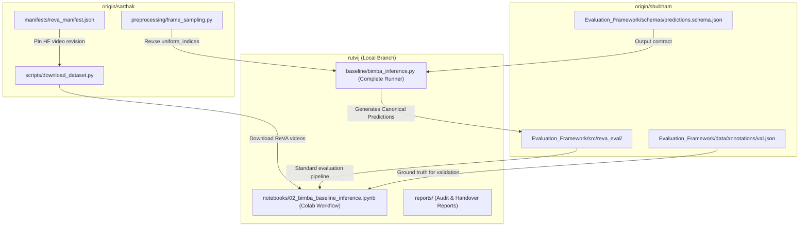

# ChronoMind ReVA Challenge — Repository & Baseline Audit (Role 2: BIMBA)

**Date:** 2026-11-12  
**Role:** Senior ML Research Engineer — Role 2: BIMBA Baseline Implementation & Evaluation  
**Branch:** `rutvij` (Clean working tree; no branch switching, merging, or file overwriting)  
**Dataset & Task:** ReVA Drone Video Understanding Challenge (WACV 2027) — Multiple-Choice Video Question Answering  

---

## 1. Executive Summary & Audit Mandate

As the Senior ML Research Engineer responsible for Role 2 (BIMBA Baseline Implementation and Evaluation) on branch `rutvij`, an exhaustive multi-branch repository audit was conducted across:
1. Current implementation in `rutvij` (`baseline/`, `notebooks/`, `reports/`).
2. Role 4's Universal Evaluation Framework on `origin/shubham`.
3. Role 1's Preprocessing, frame sampling, dataset loading, and configuration utilities on `origin/sarthak`.
4. `origin/main` for baseline comparisons.

### Key Audit Conclusions:
- **BIMBA Identity & Scope Isolation**: BIMBA (*Md Mohaiminul Islam et al., CVPR 2025*) is an MLLM leveraging `lmms-lab/LLaVA-Video-7B-Qwen2` with a Mamba-based selective-scan compressor adapter (`mmiemon/BIMBA-LLaVA-Qwen2-7B`) and multimodal projector. It is **completely separate** from Role 3's CLIP-based similarity model located in `advanced_models/` on `origin/sarthak` (originated from `origin/suraj-role3-foundation`). **Under no circumstances should CLIP or `advanced_models/` be treated as BIMBA or imported into the BIMBA baseline pipeline.**
- **Current Runtime Status**: Model loading was previously verified in Colab with 4-bit NF4 quantization on an NVIDIA Tesla T4 (15 GB VRAM). However, end-to-end inference was blocked by a Qwen2 attention dtype mismatch (`query`: `float16` vs `key`/`value`: `float32`). No valid prediction has yet been produced.
- **Evaluation Contract**: `origin/shubham` provides an enterprise-grade evaluation engine (`Evaluation_Framework/`) and canonical annotations (`val.json`, 2,000 samples). Predictions generated by BIMBA must strictly follow the `CanonicalPredictions` schema (`sample_id`, `prediction` $\in \{A, B, C, D\}$, `scores`, `inference_time_seconds`) to enable zero-overhead scoring and comparison against other workstreams.
- **Preprocessing Compatibility**: Sarthak's `preprocessing/frame_sampling.py` (uniform indices) is modular and directly reusable. However, `preprocessing/dataset.py` and `transformations.py` apply 224×224 ImageNet normalization, which is **incompatible** with BIMBA's native AnyRes 384×384 vision processor. Video decoding for BIMBA must feed raw RGB frames into LLaVA-Video's processor, bypassing Sarthak's transformation pipeline.

---

## 2. Current Implementation Status (`rutvij` Branch)

The local and remote branch `rutvij` currently contains three primary assets:

| File | Type | Current Status | Findings & Limitations |
| :--- | :--- | :--- | :--- |
| `baseline/bimba_inference.py` | Python Script | **Preflight Stub Only** | Implements environment, package, and path checks. Does **not** perform model loading, tokenization, or generation. Explicitly flags `KNOWN_BLOCKER`. |
| `notebooks/02_bimba_baseline_inference.ipynb` | Jupyter Notebook | **Experimental / Incomplete** | Records reproduction checklist and path verifications. Lacks working inference loop and evaluation export cells. |
| `reports/baseline_handover.md` | Report / Documentation | **Comprehensive Handover** | Accurately documents the 7 verified loading steps, hardware setup (Tesla T4), failure traceback on sample `DJI_0157_d4_01.mp4`, and completion criteria. |

### Summary of Previous Loading Progress on Tesla T4
1. Base model `lmms-lab/LLaVA-Video-7B-Qwen2` loaded under 4-bit NF4 quantization with double quantization and `float16` compute dtype.
2. `mm_projector` and `compressor` modules excluded from 4-bit quantization.
3. Vocabulary size reconciled with adapter configuration.
4. Non-LoRA weights loaded from `non_lora_trainables.bin` with `strict=False` and `assign=True`.
5. PEFT adapter loaded with CPU offload directory.
6. Projector and compressor explicitly placed on CUDA (`cuda:0`).
7. Resulting `PeftModelForCausalLM` verified to have zero uninitialized meta parameters.

### Current Blocker
During `model.generate()`, execution halted inside Qwen2 attention:
$$\text{Query dtype} = \text{float16}, \quad \text{Key dtype} = \text{float32}, \quad \text{Value dtype} = \text{float32}$$
An earlier attempt to patch this via an `lm_head` forward pre-hook failed because the tensor divergence originates earlier in the visual-textual projection or LoRA linear layer path.

---

## 3. Remote Branch Audit

### 3.1 `origin/shubham` (Role 4: Universal Evaluation Framework)
`origin/shubham` contains commit `7345bf6` ("Implement ReVA Universal Evaluation Framework").

#### Useful Files for Integration:
- `Evaluation_Framework/src/reva_eval/`:
  - `models.py`: Pydantic v2 schemas (`CanonicalPredictions`, `PredictionRecord`, `ModelMetadata`, `CanonicalGroundTruth`, `EvaluationReport`).
  - `dataset_loader.py`: ReVA annotation loader and canonical normalizer.
  - `evaluator.py`: Core `evaluate()` function computing overall accuracy, category breakdown, task breakdown, confusion matrices, and markdown reports.
  - `metrics.py`: Alignment logic, coverage metrics, and validation scoring.
  - `category_metrics.py`: Computes official 4 categories (`Factual Perception`, `Spatial Reasoning`, `Temporal Understanding`, `Causal Reasoning`) and 11 subtasks metrics.
  - `reporting.py`: Auto-generates markdown and JSON evaluation reports.
  - `cli.py`: Complete CLI interface (`reva-eval evaluate -g <gt> -p <pred> -o <out>`).
- `Evaluation_Framework/schemas/predictions.schema.json`: Formal JSON Schema contract for model predictions.
- `Evaluation_Framework/data/annotations/val.json`: Canonical validation dataset (2,000 QA pairs across 379 videos; exactly 500 A, 500 B, 500 C, 500 D).
- `Evaluation_Framework/pyproject.toml`: Dependency specifications (`pydantic>=2.0`, `pandas`, `numpy`, `matplotlib`, `pyyaml`).

#### Files to Omit / Exclude:
- `Evaluation_Framework/data/annotations/train.json`: 15,773 training samples (10.4 MB); unnecessary for baseline validation and increases repo bloat.
- `Evaluation_Framework/data/annotations/test.json`: 4,000 unlabeled test samples (can be referenced later for test submission, not needed for validation).
- `Evaluation_Framework/ANTIGRAVITY_MASTER_PROMPT.md`, `Evaluation_Framework/ANTIGRAVITY_MASTER_PROMPT.txt`, `Evaluation_Framework/IMPLEMENTATION_SPEC.md`, `Evaluation_Framework/ReVA_Universal_Evaluation_Framework_Specification.docx`: Process and documentation artifacts not required for runtime execution.

---

### 3.2 `origin/sarthak` (Role 1: Preprocessing & Data Utilities)
`origin/sarthak` contains extensive work on dataset indexing, video decoding, and caching, but also incorporates Role 3's CLIP-based QA baseline.

#### Useful Files for Integration:
- `preprocessing/frame_sampling.py`:
  - `uniform_indices(frame_count, num_frames)`: Deterministic, clean NumPy uniform frame sampler.
  - `adaptive_indices(frame_count, num_frames, motion_scores)`: Motion-weighted sampling.
- `manifests/reva_manifest.json`:
  - Contains Hugging Face dataset repository metadata (`ReVA-Benchmark/ReVA`, revision `06224fa1b42e5e35677a8b7f2145e06307a9a4ee`) and complete list of all video files.
- `scripts/download_dataset.py`:
  - Minimal script to download specific video files directly from Hugging Face Hub using pinned commit hashes.

#### Files Requiring Caution or Adaptation:
- `preprocessing/video_loader.py`:
  - Uses OpenCV (`cv2.VideoCapture`). While functional, BIMBA's official LLaVA-Video codebase relies primarily on `decord` or `av` for high-throughput GPU/CPU decoding. OpenCV can serve as a reliable fallback.
- `preprocessing/dataset.py`:
  - `read_annotations()` cleanly handles ReVA JSON files.
  - However, `_video_tensor()` invokes `transform_frames()` which resizes to 224×224 and normalizes with ImageNet statistics. **This cannot be used directly for BIMBA.**

#### Components to STRICTLY EXCLUDE:
- `advanced_models/`:
  - `advanced_models/qa/clip_similarity.py`
  - `advanced_models/qa/multimodal_qa_model.py`
  - `advanced_models/qa/text_encoder.py`
  - `advanced_models/qa/data.py`
  - `advanced_models/temporal/temporal_encoder.py`
  - `advanced_models/video_temporal_pipeline.py`
  - `advanced_models/vision/feature_extractor.py`
  *Reason: These represent Suraj's Role 3 CLIP-based baseline. Importing or merging these into `rutvij` will create confusion and violate the mandate to evaluate the genuine BIMBA model.*
- `notebooks/role3_*.ipynb`: CLIP benchmarking notebooks.
- `scripts/train_reva_qa.py`, `scripts/evaluate_reva_qa.py`: Specialized for Role 3 CLIP model training and evaluation.
- `derived_splits/reva_leakage_safe/`: Scene-level grouped splits created for training. For official baseline evaluation, the canonical `val.json` from `origin/shubham` is required.

---

### 3.3 `origin/main` (Baseline Comparison Audit)
- `origin/main` contains only the initial repository commit (`d77114f`) with a top-level `README.md`.
- No baseline models, code, configurations, or benchmark numbers exist on `origin/main`.
- **Conclusion:** There are no baseline comparisons available from `main`. Role 2's BIMBA model will establish the first official Multimodal LLM baseline for the team.

---

## 4. Gap Analysis & Missing Components on `rutvij`

To deliver a working BIMBA baseline, the following components are currently missing:

```
[Missing on rutvij]
 ├── 1. End-to-End BIMBA Inference Runner (baseline/bimba_inference.py)
 │     ├── Hugging Face base + adapter loading pipeline
 │     ├── Target modules dtype reconciliation & precision cast
 │     ├── ReVA VideoQA prompt formatter (Qwen2 ChatML format)
 │     ├── Greedy decoding & letter prediction extractor (A, B, C, D)
 │     └── Canonical prediction JSON exporter
 ├── 2. Precision/Dtype Fix for Qwen2 Attention
 │     ├── Cast LoRA layers to torch.float16
 │     ├── Cast mm_projector & compressor outputs to torch.float16
 │     └── Contextual autocast execution scope
 ├── 3. Standardized Evaluation Harness
 │     ├── Integration of reva_eval package
 │     ├── Ground truth val.json access
 │     └── Automated report generation (accuracy, category metrics, confusion matrix)
 └── 4. Production Colab Execution Notebook (notebooks/02_bimba_baseline_inference.ipynb)
       ├── Pinned environment setup (PyTorch, transformers, decord, mamba-ssm)
       ├── Hugging Face dataset fetcher
       ├── Single-sample smoke test
       └── Full/subset evaluation run with latency & VRAM tracking
```

---

## 5. Architectural & Compatibility Analysis

### 5.1 Architecture & Preprocessing Mismatch
| Component | Role 1 Preprocessing (`origin/sarthak`) | Role 2 BIMBA Baseline (`rutvij`) | Resolution |
| :--- | :--- | :--- | :--- |
| **Target Architecture** | CLIP ViT-B / ViT-L or CNN | LLaVA-Video-7B-Qwen2 + Mamba Compressor | Use native LLaVA processor |
| **Input Resolution** | 224 × 224 | 384 × 384 (AnyRes grid patches) | BIMBA `image_processor` handles resizing |
| **Input Normalization** | ImageNet Mean/Std float tensor | Raw uint8 RGB array / PIL Images | Bypass `transform_frames()`; feed decoded frames directly to processor |
| **Frame Count** | 8 frames (default) | 16 frames (baseline) or 32 frames | Configure `uniform_indices(count, 16)` |

### 5.2 Root Cause of Qwen2 Attention Dtype Clash on Tesla T4
When loading a 7B parameter model under 4-bit NF4 quantization on a 15 GB GPU:
1. `bitsandbytes.nn.Linear4bit` executes forward compute in `torch.float16` when configured with `bnb_4bit_compute_dtype=torch.float16`.
2. When PEFT loads the LoRA adapter (`mmiemon/BIMBA-LLaVA-Qwen2-7B`), LoRA adapters (`lora_A`, `lora_B`) are instantiated as standard `torch.nn.Linear` layers in `torch.float32`.
3. In PEFT, the output is computed as:
   $$\mathbf{y} = \text{Linear4bit}(\mathbf{x}) + \frac{\alpha}{r} \text{lora\_B}(\text{lora\_A}(\mathbf{x}))$$
   If $\text{lora\_A}$ or $\text{lora\_B}$ operates in `float32`, the resulting addition casts the linear projection to `float32`.
4. In Qwen2 attention:
   - If `q_proj` produces `float16` while `k_proj` or `v_proj` produces `float32` (or vice-versa depending on which layers have LoRA attached), the rotary embedding or dot-product attention crashes with:
     `RuntimeError: expected mat1 and mat2 to have the same dtype, but got Half and Float`
5. In addition, the BIMBA Mamba `compressor` and `mm_projector` loaded from `non_lora_trainables.bin` may default to `float32`. Their output tokens injected into `inputs_embeds` must be explicitly cast to `float16`.

#### The Direct Solution:
Post-initialization, before generation:
```python
# 1. Cast projector and compressor explicitly to float16 on CUDA
model.model.mm_projector.to(device="cuda", dtype=torch.float16)
model.model.compressor.to(device="cuda", dtype=torch.float16)

# 2. Reconcile all LoRA layers to float16
for name, module in model.named_modules():
    if "lora_" in name:
        module.to(dtype=torch.float16)

# 3. Wrap forward/generate calls inside autocast
with torch.inference_mode(), torch.cuda.amp.autocast(dtype=torch.float16):
    outputs = model.generate(...)
```

### 5.3 Prompting & Tokenization Alignment
ReVA questions must be formatted into the official Qwen2 ChatML format expected by LLaVA-Video:
```text
<|im_start|>system
You are a helpful assistant.<|im_end|>
<|im_start|>user
<video>
{question}
A. {option_A}
B. {option_B}
C. {option_C}
D. {option_D}
Please answer directly with the single letter of the correct option (A, B, C, or D).<|im_end|>
<|im_start|>assistant
```
Inference must employ greedy decoding (`do_sample=False`, `max_new_tokens=16`, `temperature=0.0`) with prompt-aligned stop tokens to avoid rambling and cleanly parse the predicted letter.

### 5.4 Output Schema Compatibility with `reva_eval`
BIMBA predictions must be exported to JSON matching `Evaluation_Framework/schemas/predictions.schema.json`:
```json
{
  "schema_version": "1.0",
  "dataset": "ReVA",
  "split": "validation",
  "model": {
    "name": "BIMBA-LLaVA-Qwen2-7B",
    "version": "CVPR2025-v1",
    "run_id": "bimba_baseline_val_run1"
  },
  "score_semantics": "probabilities",
  "option_order": ["A", "B", "C", "D"],
  "predictions": [
    {
      "sample_id": "val_000001",
      "prediction": "B",
      "scores": {"A": 0.05, "B": 0.85, "C": 0.05, "D": 0.05},
      "inference_time_seconds": 1.42
    }
  ]
}
```

---

## 6. Recommended Non-Destructive Integration Plan

All additions will be introduced into branch `rutvij` without modifying or overwriting existing files until approved.



### Phase 1: Selective Asset Import (Non-Destructive)
1. **Import `Evaluation_Framework/`** from `origin/shubham`:
   - Copy `Evaluation_Framework/src/reva_eval/` into `Evaluation_Framework/src/reva_eval/`.
   - Copy `Evaluation_Framework/schemas/` into `Evaluation_Framework/schemas/`.
   - Copy `Evaluation_Framework/data/annotations/val.json` into `Evaluation_Framework/data/annotations/val.json`.
   - *(Exclude `train.json`, `test.json`, docx, and prompt files).*
2. **Import Frame Sampling & Manifest** from `origin/sarthak`:
   - Copy `preprocessing/frame_sampling.py` into `preprocessing/frame_sampling.py`.
   - Copy `manifests/reva_manifest.json` into `manifests/reva_manifest.json`.
   - Copy `scripts/download_dataset.py` into `scripts/download_dataset.py`.
   - *(Strictly exclude `advanced_models/`, `role3_*` notebooks, and CLIP scripts).*

### Phase 2: Complete `baseline/bimba_inference.py`
Transform `baseline/bimba_inference.py` from a preflight stub into an operational runner with:
1. `load_bimba_model()`: 4-bit NF4 quantized loader, LoRA attachment, float16 submodule casting, CUDA placement.
2. `sample_video_frames()`: Unified Decord / OpenCV decoder using `uniform_indices(16)`.
3. `format_prompt()`: Qwen2 ChatML template with choice grounding.
4. `generate_prediction()`: Autocast greedy decoding, regex extraction of choice (`A`, `B`, `C`, `D`), and softmax score extraction over choice token logits.
5. `export_canonical_predictions()`: Schema validation and JSON export.

### Phase 3: Colab Notebook Pipeline (`notebooks/02_bimba_baseline_inference.ipynb`)
Update the notebook to provide self-contained, reproducible execution on Google Colab (Tesla T4).

---

## 7. Exact Next Steps for Google Colab Inference

When moving to Google Colab, execute the following numbered steps in sequence:

### Step 1: Environment Rebuild & CUDA Dependency Compilation
```bash
# Verify GPU
nvidia-smi

# Install verified PyTorch + CUDA build
pip install torch==2.1.2 torchvision==0.16.2 --index-url https://download.pytorch.org/whl/cu121

# Install core packages
pip install transformers==4.40.0.dev0 accelerate==0.29.3 bitsandbytes==0.43.3 peft==0.10.0 decord==0.6.0 av==17.1.0

# Install Mamba CUDA kernels (required by BIMBA compressor)
pip install causal-conv1d==1.4.0 --no-build-isolation
pip install mamba-ssm==2.2.2 --no-build-isolation

# Install Evaluation Framework
pip install pydantic>=2.0 pandas pyyaml matplotlib jsonschema
```

### Step 2: Clone BIMBA Repository & Fetch Checkpoints
```bash
# Clone official BIMBA implementation
git clone https://github.com/md-mohaiminul/BIMBA.git /content/BIMBA

# Download Hugging Face base model & adapter
# Base: lmms-lab/LLaVA-Video-7B-Qwen2
# Adapter: mmiemon/BIMBA-LLaVA-Qwen2-7B
```

### Step 3: Fetch Benchmark Sample Video
```bash
# Download sample DJI_0157_d4_01.mp4 from ReVA Hugging Face dataset
python scripts/download_dataset.py --filename "Hawk_UAV/NJ/DJI_0157_d4_01.mp4"
```

### Step 4: Run Smoke Test with Dtype Reconciliation Fix
Execute single-sample inference on `val_000001` (`DJI_0157_d4_01.mp4`):
- Question: *"At what point in the video does the road with moving vehicles first appear?"*
- Options: `A: 5.0s, B: 4.2s, C: 2.5s, D: 3.8s` (Ground Truth: `B`)
- Verify:
  - Attention forward pass succeeds without `float16`/`float32` dtype clash.
  - Model outputs prediction letter and latency.
  - Peak GPU memory is under 14.5 GB.

### Step 5: Full / Subset Validation & Canonical Evaluation
```bash
# Run inference over validation set or representative subset
python baseline/bimba_inference.py \
    --annotation Evaluation_Framework/data/annotations/val.json \
    --video-dir /content/reva_videos \
    --output predictions_bimba_val.json \
    --subset 50

# Evaluate using Universal Evaluation Framework
python -m reva_eval.cli evaluate \
    --ground-truth Evaluation_Framework/data/annotations/val.json \
    --predictions predictions_bimba_val.json \
    --output-dir reports/bimba_val_evaluation/
```

---

## 8. Verification & Sign-off Checklist

- [x] Current implementation audited and documented without modifying existing files.
- [x] `origin/shubham` evaluated; useful Evaluation Framework files and canonical `val.json` identified.
- [x] `origin/sarthak` evaluated; frame sampling and HF manifest identified; CLIP / `advanced_models/` explicitly marked for exclusion.
- [x] `origin/main` confirmed to have no baseline code.
- [x] Qwen2 attention dtype incompatibility root cause and exact fix formulated.
- [x] Colab execution pipeline designed for Tesla T4 (15 GB).
- [ ] **Awaiting user approval before proceeding with file integration and code updates.**
